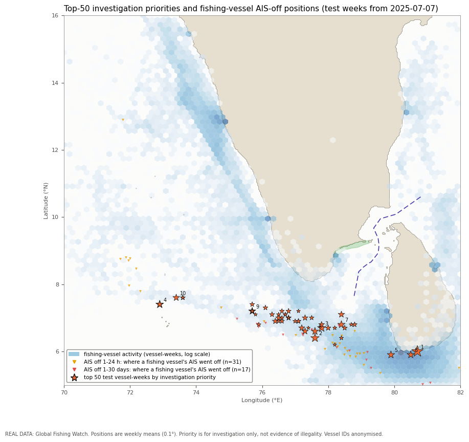

# Explainable Spatio-Temporal GNN for Illegal-Fishing Risk Detection in Indian Waters

Course project, **22AIE304 Deep Learning**, Department of Computer Science and Engineering (AIE), Amrita Vishwa Vidyapeetham, Chennai.

**Team:**
- A. Gandhimathi (CH.SC.U4AIE24001)
- H Aaryan (CH.SC.U4AIE24023)
- H R Dhanush (CH.SC.U4AIE24024)
- Jayasree Sridhar Bhuvaneswari (CH.SC.U4AIE24028)

The project ranks fishing vessels in the southern Indian EEZ for investigation, and explains every ranking. It has two parts:
- **Synthetic part:** a minute-level AIS simulator with a hidden answer key, used to validate an AIS-gap pipeline and to benchmark deep-learning baselines.
- **Real-data part:** an inductive **temporal graph-attention network (GATv2)**, trained on **five years (2021–2025) of real Global Fishing Watch data**. It forecasts each vessel's next-week behaviour. The forecasts are combined into a calibrated investigation priority, and each alert gets an explanation that is tested for faithfulness.

> **Investigation priority only.** A score or an AIS gap is never evidence of illegal activity. Vessel identities are anonymised, and every alert needs human verification.

## Contents

| Folder | What is in it |
|---|---|
| [`src/`](src) | Source code: simulator, cleaning and gap detection, baselines, graph models, real-data pipeline, explainers |
| [`notebooks/`](notebooks) | Six Colab notebooks that run the whole project end to end |
| [`tests/`](tests) | 77 unit tests, including leakage checks |
| [`results/`](results) | Final results: metrics as CSV, figures, and the executed 5-year notebooks ([summary](results/README.md)) |
| [`data/`](data) | Dataset information and the empty folders the notebooks fill ([details](data/README.md)) |
| [`DATA_SOURCE.md`](DATA_SOURCE.md) | Every dataset used: source, licence, extent, columns, restrictions |
| [`scripts/build_notebooks.py`](scripts/build_notebooks.py) | Regenerates all notebooks from source |

## Results at a glance

**Real data (Global Fishing Watch, 2021–2025).** Each model forecasts four next-week behaviours. The table gives test macro PR-AUC (mean ± s.d. over 3 seeds); a random ranking scores about 0.18.

| Model | Future weeks (time split, Jul–Dec 2025) | Unseen vessels (vessel split) |
|---|---|---|
| Persistence (this week = next week) | 0.312 | 0.357 |
| Gradient boosting (no graph) | 0.409 | **0.490** |
| Same network, no graph (MLP) | 0.354 ± 0.032 | 0.449 ± 0.001 |
| Temporal GAT, full graph | 0.400 ± 0.008 | 0.463 ± 0.002 |
| **Temporal GAT, temporal edges only** | **0.411 ± 0.004** | 0.464 ± 0.002 |

**Findings**
- Next-week behaviour can be forecast well above persistence.
- The graph helps through each vessel's own history: +0.057 over the same network without a graph. Encounter and co-location links add nothing measurable.
- Five years of training history beat two years by 0.013–0.022 for every learned model. The validation and test weeks were the same in both runs.

**Explanations (20 top alerts)**
- Mean completeness error: 0.001.
- Removing the 5 most-attributed inputs lowers the score by 0.42, against 0.006 for 5 random inputs.
- 6.9% of inputs carry 80% of the attribution.
- Mean agreement across seeds (Spearman): 0.44.

**Open problem.** Held-out Sentinel-1 radar evidence does not concentrate in the top alerts: its lift is below 1 for every model.

**Synthetic data**
- The gap pipeline finds all 12 planted blackouts.
- 81.5% of within-voyage gaps are innocent.
- The MLP baseline reaches a PR-AUC of 0.97 on 60 days of synthetic AIS.

Full tables and figures are in [`results/README.md`](results/README.md).



## Setup and execution

### Option A: Google Colab (recommended, no installation)

Each notebook's first cell clones this repository and installs what Colab lacks. You only choose the runtime and press **Runtime → Run all**.

| Step | Notebook | Open | Runtime | Time | Needs |
|---|---|---|---|---|---|
| 1 | `01_synthetic_demo` | [](https://colab.research.google.com/github/Dan-droid-A-113/IUU-Fishing-GNN-India/blob/main/notebooks/01_synthetic_demo.ipynb) | CPU | ~2 min | nothing |
| 2 | `03_baselines` | [](https://colab.research.google.com/github/Dan-droid-A-113/IUU-Fishing-GNN-India/blob/main/notebooks/03_baselines.ipynb) | CPU (T4 optional) | ~12 min | nothing |
| 3 | `04_temporal_graph_model` | [](https://colab.research.google.com/github/Dan-droid-A-113/IUU-Fishing-GNN-India/blob/main/notebooks/04_temporal_graph_model.ipynb) | T4 GPU | ~15 min | nothing |
| 4 | `02_india_real_data` | [](https://colab.research.google.com/github/Dan-droid-A-113/IUU-Fishing-GNN-India/blob/main/notebooks/02_india_real_data.ipynb) | CPU | ~1 h (first run) | GFW API token, Google Drive |
| 5 | `04b_real_graph_model` | [](https://colab.research.google.com/github/Dan-droid-A-113/IUU-Fishing-GNN-India/blob/main/notebooks/04b_real_graph_model.ipynb) | T4 GPU | ~30 min | output of step 4 on Drive |
| 6 | `05_explain_alerts` | [](https://colab.research.google.com/github/Dan-droid-A-113/IUU-Fishing-GNN-India/blob/main/notebooks/05_explain_alerts.ipynb) | T4 GPU | ~15 min | output of step 4 on Drive |

- Steps 1–3 use **synthetic data only** and run on their own.
- Steps 4–6 use **real data** and must run in order (4 → 5 → 6).
- Set the runtime with **Runtime → Change runtime type**. Do not choose a TPU: PyTorch Geometric does not support it.

**Real data: one-time setup before step 4**

1. Create a free, non-commercial API token at <https://globalfishingwatch.org/our-apis/>.
2. In Colab, open the **🔑 Secrets** panel and add a secret named `GFW_API_TOKEN` containing the token. Switch on **Notebook access**.
3. Optional: add a secret `AIS_ID_SALT` with any private text. It keys the vessel anonymisation, so published IDs cannot be reversed.
4. Run notebook 02. When asked, allow Google Drive access.
   - Downloads are cached month by month in `MyDrive/india-fishing-gnn-data/gfw_raw_cache`. An interrupted run resumes where it stopped.
   - The cleaned data are saved to `MyDrive/india-fishing-gnn-data/real_gfw`.
   - Notebooks 04b and 05 read that folder. They write their results to `outputs_04b` and `outputs_05` next to it.

Never paste the token into a notebook cell or commit it to this repository.

### Option B: run locally

Tested with Python 3.11–3.13.

```bash
git clone https://github.com/Dan-droid-A-113/IUU-Fishing-GNN-India.git
cd IUU-Fishing-GNN-India
python -m venv .venv && source .venv/bin/activate    # Windows: .venv\Scripts\activate
pip install -r requirements.txt
python -m pytest -q                                  # 77 tests, about 10 s
jupyter notebook notebooks/01_synthetic_demo.ipynb   # synthetic notebooks run on CPU
```

- For the real-data notebooks, set the token as an environment variable first: `export GFW_API_TOKEN=...`.
- `python scripts/build_notebooks.py` regenerates every notebook from source.

## Dataset information

| Dataset | Used for | Where it comes from | In this repository? |
|---|---|---|---|
| **Synthetic AIS** (Gulf of Mannar – Palk Bay; 50 vessels × 7 days and 62 vessels × 60 days) | Validating the gap pipeline; baselines; synthetic graph model | Generated by `src/synthetic.py` with seed 42; fully reproducible | No. The notebooks regenerate it in minutes. |
| **Global Fishing Watch events, 2021–2025** (fishing, encounters, loitering, port visits, AIS-off gaps), 5–16°N, 70–82°E | Real vessel-week graph; next-week targets | GFW API v3, downloaded by notebook 02 | No. Third-party data under GFW's non-commercial terms. Download it with your own free token. |
| **Sentinel-1 SAR vessel detections** (via GFW) | Held-out evidence only; never a model input | GFW API v3 | No (same terms) |
| **Map layers** (land mask, protected area, India–Sri Lanka boundary, ports) | Distances and region rules | `global-land-mask` package and approximate hand-digitised layers in `src/india_layers.py` | Yes, in code |

Details of each dataset (licence, columns, cleaning, known limits) are in [`DATA_SOURCE.md`](DATA_SOURCE.md) and [`data/README.md`](data/README.md).

After cleaning, the 5-year real data contain:
- **1,878,474** events from **14,198** fishing-related vessels (995,433 events kept);
- **250,831** vessel-week nodes with **1.59 M** edges.

## Method in brief

1. **Clean** the AIS and turn silences longer than 60 minutes into explicit gap events with context. Missing positions are never interpolated.
2. **Build a vessel × week graph** with three edge types:
   - temporal edges (the vessel's previous 3 active weeks);
   - encounter edges;
   - co-location edges (same 0.25° cell and week).
   Every edge points from the past or the same week.
3. **Model:** an MLP encoder, then 2 × GATv2 layers with a learned time encoding, then 4 heads. The heads forecast four behaviours next week: an encounter, loitering, fishing inside a protected area, and fishing outside the flag state's EEZ. Training is inductive, on the training subgraph only.
4. **Priority:** Platt-calibrate each forecast, then combine them with a weighted noisy-OR: `π = 1 − ∏ (1 − p_t)^w_t`.
5. **Explain** each alert with Integrated Gradients on its exact 2-hop subgraph, occlusion of past weeks and links, and counterfactuals. Check completeness, deletion fidelity, sparsity and cross-seed stability.
6. **Evaluate** on two splits, against persistence, gradient boosting and a no-graph ablation, plus held-out SAR and GFW evidence:
   - **time split:** train 2021 to Mar 2025, validate Apr–Jun 2025, test Jul–Dec 2025, with a one-week embargo between them;
   - **vessel split:** 70/15/15% of vessels.

## Code layout

```
src/synthetic.py       minute-level AIS simulator, coverage model, hidden truth
src/preprocessing.py   cleaning, kinematics, AIS-gap events with context, resampling
src/graph_builder.py   proximity search and space-time-prism "possible dark encounter" links
src/windows.py         6-h vessel windows (36 x 10-min steps), features, synthetic labels
src/baselines.py       rule, MLP, GRU, TCN and the training loop
src/temporal_gnn.py    synthetic temporal GAT with gap-path decoder
src/gfw_real.py        Global Fishing Watch download (async, month cache), anonymisation
src/real_model.py      real vessel-week graph, temporal GATv2, baselines, calibration, priority, evidence
src/explainers.py      Integrated Gradients, occlusion, counterfactuals, faithfulness checks, alert cards
src/splits.py          vessel-, time- and region-disjoint splits
src/evaluation.py      metrics and gap detection against the synthetic truth
src/india_layers.py    land mask, protected area, boundary, ports
src/visualization.py   maps and figures
tests/                 77 pytest unit tests
```

## Limitations

- No confirmed IUU labels exist for Indian waters, so the priority forecasts observable behaviour, not illegality.
- AIS-gap and carrier-encounter targets were too rare to train (2 and 1 training positives).
- The protected-area and boundary layers are approximations.
- Small vessels without AIS are visible only through radar.
- For 4 of the 20 explained alerts, the extracted subgraph did not reproduce the full-graph score.

## Licence and data terms

- **Code:** MIT licence (see [`LICENSE`](LICENSE)).
- **Real data:** © Global Fishing Watch, used under its non-commercial terms with attribution. No GFW data are redistributed here.
- **Published results:** contain only aggregate metrics, figures and anonymised, rank-numbered alerts.
