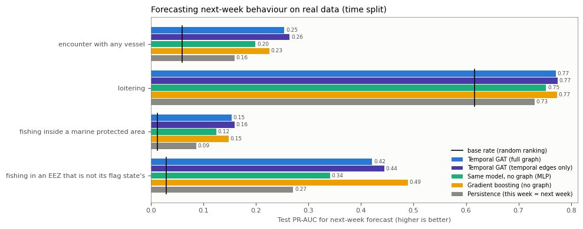
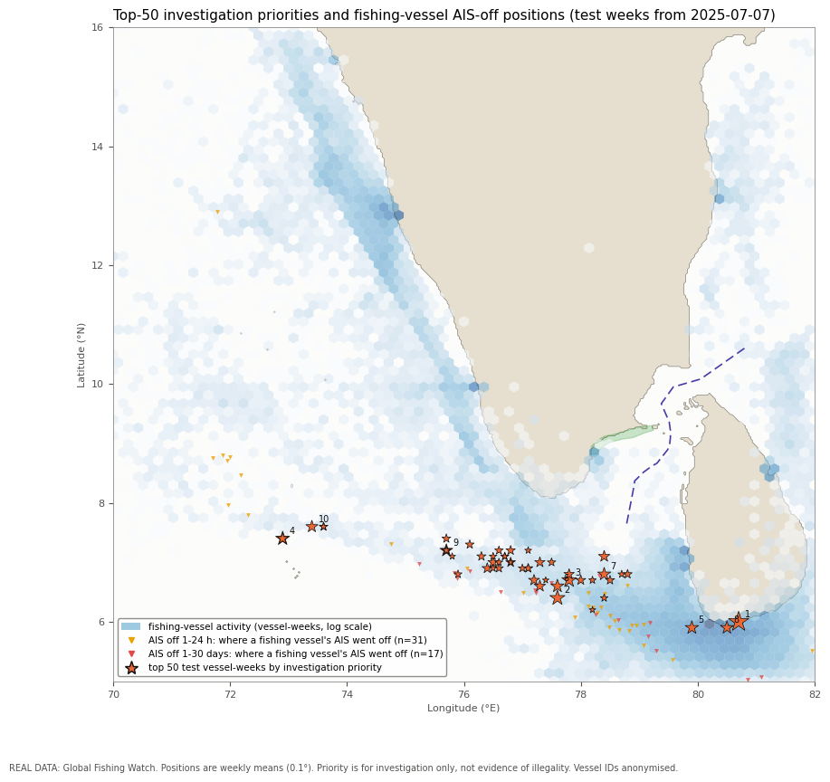
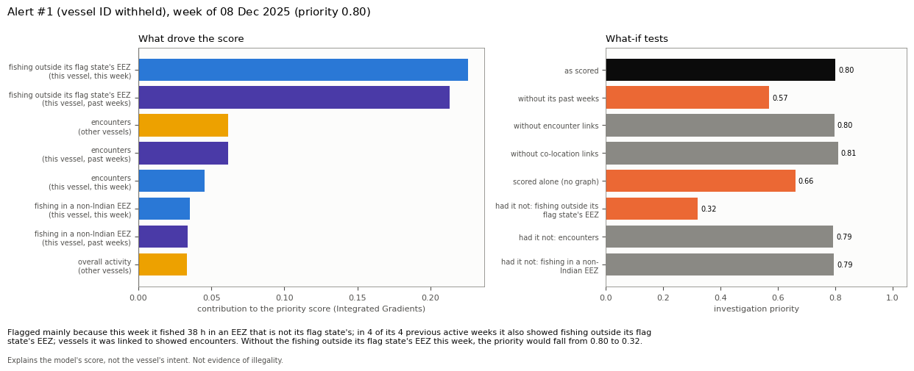

# Results

These are the final results of the project:
- **Real data** come from five years (2021–2025) of Global Fishing Watch data, using notebooks 04b and 05, trained on a free Colab T4 GPU.
- **Synthetic data** come from notebooks 01 and 03.

Every number below is copied from the executed notebooks in [`executed_notebooks/`](executed_notebooks). In those notebooks and in every file here:
- vessel identifiers are replaced with `vessel_########`;
- alerts are referred to only by rank.

| Folder | Contents |
|---|---|
| [`real_5yr/`](real_5yr) | Metrics as CSV and figures for the real-data model |
| [`synthetic/`](synthetic) | Gap-detection and baseline results on synthetic AIS |
| [`executed_notebooks/`](executed_notebooks) | Notebooks 04b and 05 with their full outputs (5-year run, anonymised) |

## 1. Real data: forecasting next-week behaviour

For each vessel-week, the models forecast four behaviours in the vessel's next active week:
- an encounter with any vessel;
- loitering;
- fishing inside a marine protected area;
- fishing outside the vessel's flag state's EEZ.

The scores are test **macro PR-AUC** (the mean over the four tasks) with ROC-AUC beside it, as mean ± s.d. over 3 seeds. A random ranking scores about 0.18. ([`model_scores.csv`](real_5yr/model_scores.csv))

| Model | Time split: PR-AUC | Time split: ROC-AUC | Vessel split: PR-AUC | Vessel split: ROC-AUC |
|---|---|---|---|---|
| Persistence (this week = next week) | 0.312 | 0.641 | 0.357 | 0.668 |
| Gradient boosting (no graph) | 0.409 | 0.832 | **0.490** | 0.874 |
| Same network, no graph (MLP) | 0.354 ± 0.032 | 0.777 | 0.449 ± 0.001 | 0.857 |
| Temporal GAT, full graph | 0.400 ± 0.008 | 0.829 | 0.463 ± 0.002 | 0.874 |
| Temporal GAT, temporal edges only | **0.411 ± 0.004** | 0.834 | 0.464 ± 0.002 | 0.873 |

**The two splits**
- **Time split:** train Jan 2021 – early Apr 2025 (195,906 vessel-weeks); validate 7 Apr – 7 Jul 2025 (12,856); test Jul–Dec 2025 (39,295). 2,774 vessel-weeks at the boundaries are left out (the embargo).
- **Vessel split:** 70/15/15% of vessels.

**Per task, time split** ([`task_pr_auc.csv`](real_5yr/task_pr_auc.csv))

| Task | Base rate | Persistence | No graph | Gradient boosting | GAT full | GAT temporal |
|---|---|---|---|---|---|---|
| Encounter | 0.059 | 0.159 | 0.199 | 0.225 | 0.254 | **0.264** |
| Loitering | 0.617 | 0.731 | 0.752 | 0.773 | 0.771 | **0.774** |
| Fishing in a protected area | 0.013 | 0.087 | 0.124 | 0.148 | 0.154 | **0.159** |
| Fishing outside the flag state's EEZ | 0.029 | 0.271 | 0.341 | **0.489** | 0.421 | 0.444 |

## 2. What the graph adds

([`graph_ablation.csv`](real_5yr/graph_ablation.csv))

- Removing the graph layers lowers future-week PR-AUC from 0.411 to 0.354. So message passing helps, and the useful part is the vessel's own past weeks.
- Adding encounter and co-location edges does not help (0.400 vs 0.411). This holds even on vessel-weeks that have such neighbours (0.399 vs 0.409).

| Time split, macro PR-AUC | 2 years (2024–2025) | 5 years (2021–2025) | Change |
|---|---|---|---|
| Persistence | 0.311 | 0.312 | +0.001 |
| Gradient boosting | 0.387 | 0.409 | +0.022 |
| Temporal GAT, full graph | 0.387 | 0.400 | +0.013 |
| Temporal GAT, temporal edges only | 0.392 | 0.411 | +0.019 |
| Same network, no graph | 0.356 | 0.354 | −0.002 |

Both runs used the same validation and test weeks. The only difference is how much training history the models had ([`two_vs_five_years.csv`](real_5yr/two_vs_five_years.csv)).

## 3. Top alerts and held-out evidence

**Top alerts** ([`top20_alerts_anonymised.csv`](real_5yr/top20_alerts_anonymised.csv))
- The 25 highest-priority test alerts are all fishing vessels south of India and Sri Lanka (5.9–7.6°N).
- Each is driven by fishing outside its flag state's EEZ.
- Of the top 20, 17 showed a flagged behaviour in the following week. 13 of them fished outside their flag state's EEZ again.

**Held-out evidence** ([`heldout_evidence_lift_top5pct.csv`](real_5yr/heldout_evidence_lift_top5pct.csv)). This is evidence the model never saw. The figure is the lift in the top 5% of scores, where 1 means no better than random.

| Evidence | Activity only | Persistence | Gradient boosting | No graph | GAT full | GAT temporal |
|---|---|---|---|---|---|---|
| Unmatched Sentinel-1 detection within 5 km of fishing (time split) | 0.60 | 0.10 | 0.10 | 0.06 | 0.08 | 0.12 |
| GFW intentional-disabling gap (time split; base rate 0.05%) | 2.0 | 4.0 | 2.0 | 4.7 | 2.0 | 2.0 |

Radar evidence does not concentrate in the top alerts. The alerts are offshore, while Sentinel-1 images coastal waters more often. We report this as the main open problem.

## 4. Explanations (notebook 05)

The 20 top alerts were each explained with:
- Integrated Gradients on the alert's exact 2-hop subgraph;
- occlusion of past weeks and links;
- counterfactuals.

([`explanation_quality_top20.csv`](real_5yr/explanation_quality_top20.csv))

| Check | Mean | Median |
|---|---|---|
| Completeness error (0 = attributions add up exactly) | 0.0011 | 0.0005 |
| Score drop, top-5 inputs removed | 0.421 | 0.387 |
| Score drop, 5 random inputs removed | 0.0058 | 0.0033 |
| Share of inputs carrying 80% of the attribution | 6.9% | 6.1% |
| Agreement across 3 trained seeds (Spearman) | 0.44 | 0.48 |

**Feature importance** ([`feature_importance.csv`](real_5yr/feature_importance.csv)). Permutation importance shows the two models rely on different things:
- the graph model relies on **behaviour**: foreign-EEZ fishing 0.063, loitering 0.036, encounters 0.022;
- gradient boosting relies on **location** (0.100) and distance from shore (0.047).

**Known issue.** For 4 of the 20 alerts (ranks 7, 12, 14 and 18), the extracted subgraph scored 0.06–0.14 lower than the full graph.

## 5. Synthetic data (notebooks 01 and 03)

**Gap detection** ([`gap_detection_7day.csv`](synthetic/gap_detection_7day.csv))
- All 12 planted blackouts were found among 328 gaps.
- 81.5% of within-voyage gaps are innocent: coverage holes, receiver outage, faults.

**Baselines** (60 days, 9,618 six-hour windows, 7.4% suspicious; mean over 3 seeds; [`baselines_60day.csv`](synthetic/baselines_60day.csv)):

| Split | Model | PR-AUC | F1 | False alerts / 1,000 vessel-h | Event recall |
|---|---|---|---|---|---|
| Vessel-disjoint | Rule (reference) | 0.930 | 0.870 | 0.2 | 0.96 |
| Vessel-disjoint | MLP | **0.973 ± 0.005** | **0.909** | 2.9 | 0.99 |
| Vessel-disjoint | GRU | 0.815 ± 0.065 | 0.755 | 9.4 | 0.99 |
| Vessel-disjoint | TCN | 0.882 ± 0.029 | 0.797 | 6.1 | 1.00 |
| Time-disjoint | Rule (reference) | 0.889 | 0.855 | 0.5 | 0.98 |
| Time-disjoint | MLP | **0.976 ± 0.003** | **0.928** | 0.5 | 1.00 |
| Time-disjoint | GRU | 0.854 ± 0.012 | 0.806 | 4.7 | 0.99 |
| Time-disjoint | TCN | 0.912 ± 0.005 | 0.831 | 3.8 | 1.00 |

The synthetic suspicious behaviour is partly rule-shaped. These scores therefore validate the pipeline; they are not expected to carry over to real AIS.
